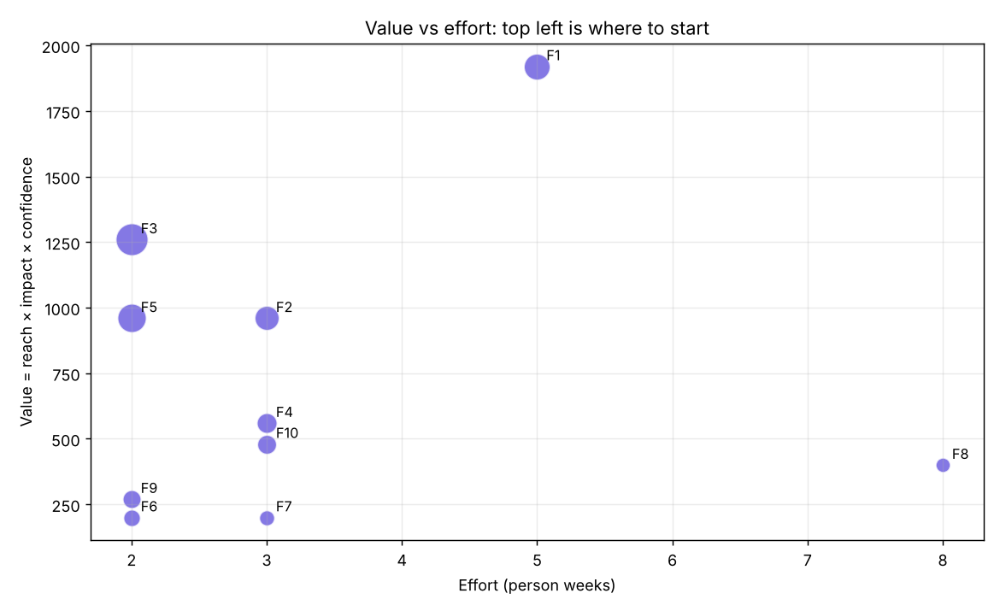

# Product owner portfolio

**One feature, taken through the whole product cycle: from a vague problem to a sprint the team can start on Monday.**

I spent two years as a Scrum Product Owner at PuppyDog.io, an AI B2B SaaS startup. Product work usually lives in private Jira boards and Confluence pages, so this repo recreates the full set of artifacts in the open for one realistic feature: a **revenue forecast for event organizers** on [EventCast](https://github.com/sarimyawaredu-crypto/eventcast_case_study).

## The feature in one sentence

> When an organizer is choosing a date, show them the expected attendance and revenue range, the competing events on the same night, and how their candidate dates compare.

## The artifacts

| # | Artifact | What it shows |
|---|---|---|
| 1 | [Problem and discovery plan](artifacts/01_problem_and_discovery.md) | Problem statement, assumption map ranked by risk, interview guide, cheapest tests before building |
| 2 | [PRD](artifacts/02_prd.md) | Goals and non goals, requirements with MoSCoW priority, success metrics, guardrails, risks |
| 3 | [Epics and user stories](artifacts/03_user_stories.md) | INVEST stories with Gherkin acceptance criteria, Definition of Ready and Done |
| 4 | [Prioritisation](artifacts/04_prioritization.md) | RICE scoring, **where the formula is wrong** and how dependencies change the order |
| 5 | [Roadmap](artifacts/05_roadmap.md) | Gantt timeline, Now / Next / Later, explicit decision points |
| 6 | [Sprint 1 plan](artifacts/06_sprint_plan.md) | Sprint goal, capacity with focus factor, commitment, risks |
| 7 | [Metrics and experiment](artifacts/07_metrics_and_experiment.md) | Metric tree, A/B test design with sample size and a decision rule agreed upfront |
| 8 | [Stakeholder update](artifacts/08_stakeholder_update.md) | A sprint review update leadership can read in one minute |

Plus [issue templates](.github/ISSUE_TEMPLATE) for stories and bugs, so the repo works as a starting point for a real backlog.

## The tools

Two small, tested Python tools so the numbers in the artifacts are calculated, not guessed:

```bash
python tools/rice.py                      # rank the backlog and plan releases around dependencies
python tools/rice.py --chart images/rice.png
python tools/sample_size.py --baseline 0.20 --mde 0.05 --weekly 300
python -m pytest tools/tests              # 7 tests
```



## Three things I'd want a hiring manager to notice

1. **Assumptions are tested before anything is built.** The discovery plan ranks assumptions by risk and lists the cheapest test for each: interviews, a concierge forecast and a fake door.
2. **Frameworks are tools, not answers.** RICE ranked "explain the forecast" above the forecast itself. The [prioritisation](artifacts/04_prioritization.md) shows how I caught that and what else I overrode, with reasons.
3. **Every metric comes with a guardrail and a decision rule**, agreed before the experiment starts, so the result can't be argued into whatever we hoped for.

## How this connects

* [eventcast_case_study](https://github.com/sarimyawaredu-crypto/eventcast_case_study): the product this feature belongs to
* [event_demand_forecast](https://github.com/sarimyawaredu-crypto/event_demand_forecast): a working prototype of the forecast model

*This is a portfolio exercise. The feature is realistic and built around EventCast's real product, but the numbers in the backlog, sprint plan and stakeholder update are illustrative.*
