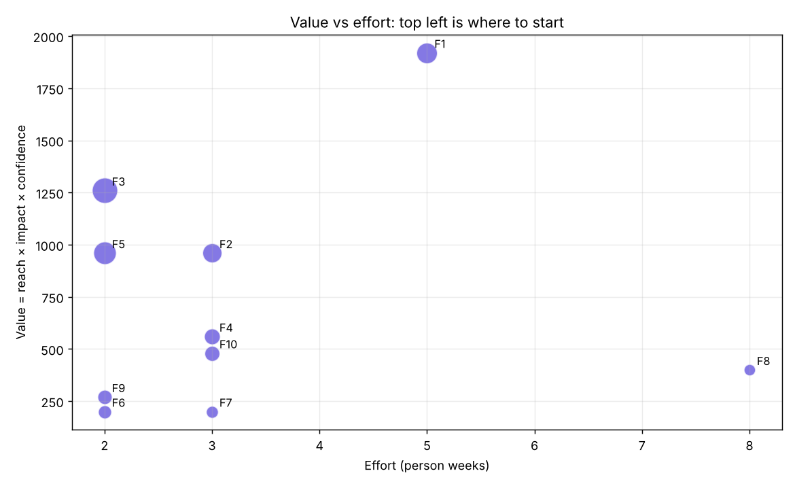

# 4 · Prioritisation

## Method: RICE

**RICE = Reach × Impact × Confidence ÷ Effort**

| Factor | Scale used here |
|---|---|
| Reach | Organizers affected per quarter |
| Impact | 3 massive · 2 high · 1 medium · 0.5 low · 0.25 minimal |
| Confidence | How sure we are about reach and impact (40% to 100%) |
| Effort | Person weeks across design, engineering and data |

The scores come from [`tools/backlog.csv`](../tools/backlog.csv) and are calculated by [`tools/rice.py`](../tools/rice.py), so the ranking can be re run whenever an estimate changes.

## Ranking

| Rank | ID | Item | Reach | Impact | Confidence | Effort | RICE |
|---|---|---|---|---|---|---|---|
| 1 | F3 | Competing events on the same night | 700 | 2 | 90% | 2 | **630** |
| 2 | F5 | Explain the forecast in plain language | 800 | 2 | 60% | 2 | **480** |
| 3 | F1 | Revenue range for a chosen date and venue | 800 | 3 | 80% | 5 | **384** |
| 4 | F2 | Compare up to 3 candidate dates side by side | 600 | 2 | 80% | 3 | **320** |
| 5 | F4 | Seasonality and tourism demand signal | 800 | 1 | 70% | 3 | **187** |
| 6 | F10 | Venue capacity lookup | 600 | 1 | 80% | 3 | **160** |
| 7 | F9 | Forecast accuracy tracking after the event | 300 | 1 | 90% | 2 | **135** |
| 8 | F6 | Export forecast as PDF for sponsors | 250 | 1 | 80% | 2 | **100** |
| 9 | F7 | Email alert when a competing event is announced | 400 | 1 | 50% | 3 | **67** |
| 10 | F8 | Ticket price suggestion | 500 | 2 | 40% | 8 | **50** |

## Where the score is wrong, and what I did about it

**Pure RICE put "Explain the forecast" (F5) above the forecast itself (F1).** It's cheap and high impact, but there's nothing to explain until F1 exists. A ranking formula doesn't know about dependencies, so the planning tool takes a `depends_on` column and never schedules an item before what it depends on:

| Release | Items | Effort |
|---|---|---|
| 1 | F3 Competing events · F1 Revenue range | 7 person weeks |
| 2 | F5 Explanation · F2 Compare dates · F4 Seasonality | 8 |
| 3 | F10 Venue capacity · F9 Accuracy tracking · F6 PDF export | 7 |
| 4 | F7 Competing event alerts | 3 |
| 5 | F8 Ticket price suggestion | 8 |

**Other judgement calls on top of the numbers**

* **F8 Ticket price suggestion** has high potential impact but only 40% confidence, and it's the most expensive item. It stays last until accuracy tracking (F9) shows the core forecast is reliable. A wrong price suggestion costs organizers real money.
* **F9 Accuracy tracking** scores modestly but is the only way to learn whether the forecast works. I'd argue to pull it into release 2 if engineering capacity allows.
* **F3 Competing events** ships first: it has the highest confidence because it reuses the existing event pool, and it's useful on its own even before the forecast exists.
