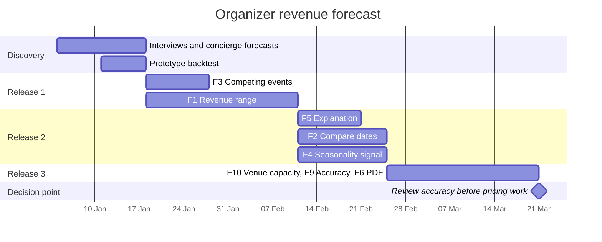

# 5 · Roadmap

Two week sprints, starting January 2027. Dates are a plan, not a promise. They move when we learn something.

## Now / Next / Later

| Now (Q1 2027) | Next (Q2 2027) | Later |
|---|---|---|
| Competing events on the same night | Venue capacity lookup | Ticket price suggestion, once accuracy is proven |
| Revenue range for a date | Forecast accuracy tracking | Alerts when a competing event is announced |
| Plain language explanation | PDF export for sponsors | Forecasts for cities beyond the pilot |
| Compare candidate dates | | |

## Decision points

* **End of discovery:** if fewer than half of interviewed organizers compare dates, narrow the scope to competing events only.
* **After release 3:** if the forecast range contains actual attendance in under 70% of reported events, fix the model before starting price suggestions.
