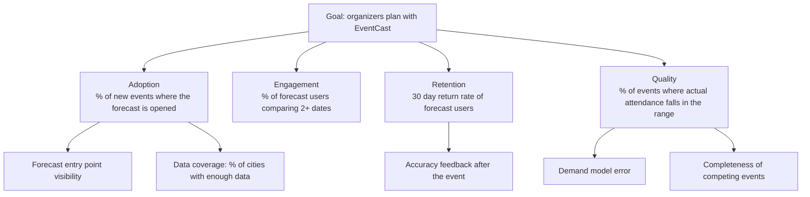

# 7 · Metrics and experiment design

## Metric tree



## Experiment: does showing the forecast increase 30 day retention?

| | |
|---|---|
| **Hypothesis** | Organizers who see a forecast while creating an event are more likely to come back to EventCast within 30 days, because the forecast makes EventCast part of their planning. |
| **Design** | Randomised A/B test at organizer level. Control: current add event flow. Variant: forecast panel in the flow. |
| **Primary metric** | 30 day return rate |
| **Guardrail** | Event publishing completion rate must not drop by more than 2 points |
| **Baseline** | 20% return within 30 days (assumed for planning) |
| **Minimum effect worth detecting** | +5 points (20% → 25%) |

### Sample size

```bash
python tools/sample_size.py --baseline 0.20 --mde 0.05 --weekly 300
# 1094 organizers per group (2188 total)
# About 7.3 weeks at 300 organizers per week
```

With 5% significance and 80% power, we need about **1 094 organizers per group**. At 300 new organizers a week that's about **7 to 8 weeks**. If that's too slow, the options are to accept detecting only a larger effect (+10 points needs far fewer organizers) or to start with one city as a pilot and treat the result as directional.

### Decision rule (agreed before the test starts)

* **Ship** if retention improves significantly and the guardrail holds.
* **Iterate** if retention is flat but engagement (dates compared) is high: the forecast is used but not yet valuable enough.
* **Stop** if the guardrail is breached: the forecast is getting in the way of publishing.
